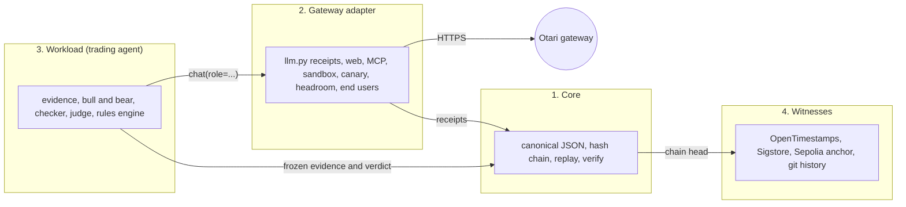

# Architecture

Verdict Desk on Otari is a tamper-evident receipt layer for an agent that calls models through an AI gateway. Every model or tool call leaves a receipt, the receipts are sealed with the agent's decision into a hash-chained ledger, and anyone can check the chain and replay the decision offline. The paper-trading agent in this repository is the reference workload that exercises it.

The code falls into four parts. The first two are the product, the third is one example of a workload, and the fourth is how the outside world holds a copy of the chain head.



Python 3 and its standard library are enough; there is no dependency to install. The browser pages are static files that recompute the same hashes.

## 1. Core

Nothing here knows about markets or models. It is the part a second agent reuses as it is.

| Piece | Where | What it does |
|---|---|---|
| Canonical JSON | `verdict_desk/canonical.py` (`canonical(obj) -> bytes`), `web/canonical.js` | Sorted keys, no whitespace, numbers printed the way ECMAScript prints them (RFC 8785 style), so Python and the browser hash the same text. `tests/canonical_vectors.json` pins the two together. |
| Hash chain | `dossier.digest(body)`, `dossier.GENESIS`, `ledger/ledger.jsonl` | One JSON object per line. `hash` is the SHA-256 of the canonical body, and the body holds `prev_hash`. The first `prev_hash` is 64 zeros. |
| Verify | `dossier.verify(ledger)`, `python3 -m verdict_desk verify`, `web/verify.html` | Walks the chain: every `prev_hash` must match the record before it and every hash must match its body. An edit, deletion, swap or truncation is reported by sequence number. |
| Head | `dossier.head(ledger)` | The `{seq, hash, symbol}` of the last record, refused if the chain is broken. It is what the witnesses copy. |
| Replay | `dossier.replay(dossier, rules_version)`, `python3 -m verdict_desk replay` | Recomputes features and the verdict from the evidence frozen in the record and compares them with what was recorded. It also rechecks what can be recomputed without a network: that every accepted claim still validates against the frozen evidence, the judge route, the canary verdict, the web excerpt check, the MCP price check and the local half of the sandbox check. |
| Attack battery | `verdict_desk/battery.py`, `python3 -m verdict_desk battery` | Edits, deletes, swaps, forges, truncates and re-hashes a copy of the ledger and counts what the verifier misses. |

A record is `{seq, prev_hash, ...fields, hash}`. Which fields exist is the workload's business. The only fields the core itself reads are `seq`, `prev_hash` and `hash`, plus `evidence.symbol` in `dossier.head`.

Three functions in `dossier.py` are tied to the workload today: `build` and `append` (they run the trading steps of section 3) and `replay` (it dispatches by `rules_version` to the trading modules).

## 2. Gateway adapter

This is the Otari-specific part. It lives mostly in `verdict_desk/llm.py` (the Otari and receipt functions), with the tools in their own modules.

**Calls and roles.** `llm.chat(system, user, role=..., max_tokens=..., end_user=..., extra=...)` returns the model's text. With `OTARI_API_KEY` set it goes to the gateway (`_otari_chat`), otherwise to the older provider path. `config/otari.json` maps each role to one open-weight catalog id (`llm.role_model`, validated by `llm.otari_config`) and optionally to a routing policy (`llm.sent_model`). There are nine roles: `bull`, `bear`, `judge`, `checker`, `narrator`, and four tool roles (`searcher`, `fetcher`, `sandbox`, `mcp`).

**Receipts.** After each call `llm.served_receipt()` returns the sealed `otari-receipt/1` of the last call on this thread, read once. `llm.parse_receipt` builds it from the response headers and the usage block: request id (Otari's own, or `client:<idempotency key>` when the gateway never answered), model asked for, provider and model that answered, attempts, fallback, duration, tokens, cost as the string Otari sent, guardrail result, end user and budget. `_seal_exchange` adds how the call stopped and the SHA-256 of the prompt and of the answer, so a stored answer is tied to its prompt without storing either. A refusal or a failure gets a receipt too (`refusal_receipt`, `transport_receipt`), so no call is anonymous.

**Per-role end users and budgets.** Each role is billed to its own end user, `end_user_prefix` plus the role (`vd-judge`). The `Otari-End-User-Budget` header carries the budget id when the call creates the end user. Otari enforces the budget. The app adds its own caps on top: `llm.cycle_cap` and `_cycle_check` stop starting new calls once a cycle has spent its limit, and the refusal is a client-side receipt (`cycle_cap_exceeded`), never presented as Otari's. `llm.cycle_status()` is sealed into the dossier.

**Retries.** One logical call keeps one `Idempotency-Key` across retries, so a lost reply is not billed twice. A `409 ... still in progress` is polled for on the same key (`_poll_delay`), separately from real failures (`_retry_or_raise`).

**Tools and checks driven through the gateway.**

| Module | What it does | What is sealed |
|---|---|---|
| `otari_web.py` | One web search and one page fetch through Otari's tools (`collect`, `fetch_page`) | The sources Otari reports, a verbatim excerpt with its hash, and `excerpt_check` against our own GET of the page |
| `otari_mcp.py` | Reads prices from a public MCP server through Otari's managed loop (`collect`), checks the code the model wrote, cross-checks the price against the exchange (`check_for`, `apply`) | The server's own result block and the check. A trusted price that diverges beyond tolerance makes the packet's freshness fail closed |
| `sandbox_rederive.py` | Re-derives the verdict arithmetic in Otari's code sandbox with a fresh nonce (`seal`) and compares it with a local run (`run_local`, `agrees`) | Both outputs, the nonce proof, the code that ran, whether they are identical. `recheck` redoes the local half in a replay |
| `otari_canary.py` | One small call per cycle through a policy built to fail over (`run`, `passes`) | The receipt, with `Otari-Fallback` and the attempt count |
| `llm.read_headroom` | Reads each end user's spend from `GET /end-users` (`end_user_lookup`) | The numbers and how each lookup went. `llm.route_decision` uses them, and the canary, to decide whether the judge may take the larger model |
| `otari_report.py` | `audit` proves the eight Otari resources from sealed receipts, `reconcile` compares receipts with Otari's usage log by request id, `board` groups every call by the model that answered | Nothing: it reads the ledger, prints, and refreshes the README blocks |
| `otari_drill.py` | Real requests that show a fallback and a budget refusal | Written to `docs/evidence/otari-drills.jsonl`, not to the ledger |

`web/cycle.html` (with `web/cycle.js`) draws one cycle from these receipts as a timeline.

## 3. Workload: the trading agent

Everything below is specific to paper trading. A different agent would replace this part and keep the other three.

| Step | Where | Notes |
|---|---|---|
| Evidence | `evidence.collect`, `narrative.build`, `otari_web.collect`, `otari_mcp.collect` | Public candles, funding, news and market voices, plus one web page and one MCP price read. Collected once and frozen in the dossier's `evidence`. |
| Features | `features_v2.compute(packet)` | Indicators computed from the frozen packet only. |
| Evidence index | `citations.index(packet, feats)` | Stable ids (E1, E2, ...) for every citable fact. |
| Bull and bear | `llm.argue(side, items)`, `citations.validate(claims, items)` | Each analyst, on its own model, returns claims that cite ids. A claim survives only if its ids exist and its numbers appear in the cited items. |
| Checker | `llm.check_claims(labels, items)` | A third model re-reads each surviving claim against its citations. |
| Judge | `llm.rule(labels, items)`, `citations.validate_ruling` | Sees only validated claims. Routed by `llm.route_decision`. |
| Rules engine | `agents_v7.decide`, built on `agents_v2` (`bull`, `bear`, `judge`, `checker_gate`) | Plain deterministic code. It turns the weighted arguments into a paper-trade verdict inside declared risk limits. Under rules v7 a claim the checker marked unsupported voids a judge lean that rests on it. |
| Wiring | `dossier.analyst_layer`, `dossier.build`, `dossier.append` | Runs the steps above in order and seals the body with `digest`. `_mods(rules_version)` picks the module set, so older dossiers replay under the rules they were recorded with. |
| Entry point | `python3 -m verdict_desk decide-v7 BTCUSDT --config config/voices.json` | `_decide_flow` in `verdict_desk/__main__.py`. |

Only the verdict arithmetic is re-derived. Model text cannot be regenerated, so the replay checks that every accepted claim still validates against the frozen evidence and that the checker marks and the route recompute from what was sealed.

## 4. Witnesses

A hash chain shows that a record was not edited after it was written. It does not show who held the whole chain. The witnesses are copies of the head that the operator does not control.

| Witness | Where | Status in the Otari era |
|---|---|---|
| OpenTimestamps (Bitcoin) | `tools/otari_runner.py` writes `ledger/timestamps/<seq>.json` from the head and stamps it with `ots stamp`; `web/ots.js` and `web/witnesses.html` check the proof in the browser | Continues every cycle. A fresh proof reads pending until a calendar answers with a Bitcoin block, and the runner asks again for the newest earlier proofs. |
| Sigstore (Rekor) | `ledger/rekor/*.bundle.json`, `web/rekor.js` | Bundles exist up to dossier 791. They were signed by the earlier project's workflow, which is not in this repository. |
| Sepolia anchor | `verdict_desk/anchor.py` (`monitor`, read-only), `cre/` (Chainlink CRE workflow and contract) | Earlier era only. It needs a key this branch does not have. |
| Git history | The runner's commits | The commit time of each pushed dossier is a clock the operator does not set. |

`python3 -m verdict_desk witnesses` writes the index the witnesses page reads, and `battery` also attacks the witness checks.

## One cycle, in order

1. `tools/otari_runner.py --once` (run by the workflow `otari-cycle`) starts `decide-v7` for one symbol.
2. `llm.reset_cycle()`. The narrator reads headlines, `otari_web.collect` searches and fetches one page, `otari_mcp.collect` reads prices, and `evidence.collect` gathers candles, funding and news.
3. `dossier.build` computes the features. `analyst_layer` runs bull, bear and checker, then the canary and the headroom read, then the judge. `agents_v7.decide` produces the verdict, `sandbox_rederive.seal` re-derives it in the sandbox, and `digest` seals the record.
4. `dossier.append` writes the line, and `publish_head` refreshes `ledger/head.json`.
5. The runner runs `verify` and `replay`, stamps the head, refreshes the README blocks, scans for secrets, commits and pushes to `otari`.

## Bring your own agent

Today a second agent can reuse the gateway adapter and the chain check as they are, and has to write a small amount of glue and its own replay. There is no `seal()` function to call yet. This is exactly what a second workload touches.

**1. Roles.** Add its roles to `config/otari.json` under `roles`, each with a catalog `model`. `llm.otari_config` refuses a role without one, and `llm.chat` refuses a role that is not listed. `tools/otari_catalog_check.py` checks that the ids are real and open-weight.

**2. Calls.** Call `llm.chat(..., role=...)` and read `llm.served_receipt()` straight after, on the same thread. Call `llm.reset_cycle()` before a cycle and `llm.cycle_status()` after it. Receipts, per-role end users, the budget header, idempotent retries and the cycle caps come with it.

**3. A deterministic decision.** The agent needs a function from its frozen evidence to its decision, which is what `agents_v2.decide` is for trading. If its claims should cite evidence, `citations.validate(claims, items)` works on any `{id: text}` dict, but `citations.index` reads `packet["market"]` and the prompts in `llm.argue` and `llm.rule` are about a market debate, so the agent writes its own index and prompts.

**4. Sealing.** `dossier.build` and `dossier.append` are wired to the trading steps, so a second agent seals its own record. This sketch of the glue uses only functions that exist. It is what `dossier.append` does without the trading parts:

```python
import json
from pathlib import Path
from verdict_desk import dossier, llm

def seal(path: Path, evidence: dict, decision: dict, receipts: dict[str, dict]) -> dict:
    ledger = dossier.read_ledger(path)
    prev = ledger[-1]["hash"] if ledger else dossier.GENESIS
    body = {
        "seq": len(ledger) + 1,
        "prev_hash": prev,
        "evidence": evidence,                     # must hold "symbol" for dossier.head
        "decision": decision,
        "llm": {"otari": llm.otari_summary(),     # marks the record as an Otari-era dossier
                **{role: {"receipt": r} for role, r in receipts.items()}},
    }
    record = {**body, "hash": dossier.digest(body)}
    with path.open("a", encoding="utf-8") as fh:
        fh.write(json.dumps(record, ensure_ascii=False) + "\n")
    return record

llm.reset_cycle()
answer = llm.chat(SYSTEM, case_text, role="judge", max_tokens=400)
receipt = llm.served_receipt()
seal(Path("ledger/ledger.jsonl"), {"symbol": case_id, "case": case_text},
     decide(answer), {"judge": receipt})
```

That is about a dozen lines. I ran the sketch on a scratch ledger with a receipt built by `llm.parse_receipt` from made-up headers: `dossier.verify` returned no problems, `dossier.head` returned the head, `python3 -m verdict_desk --ledger PATH verify` printed `Chain intact`, and `otari_report.calls_of` found the receipt. It was not run against the live gateway.

**5. Replay.** The agent ships its own `replay(record)` that recomputes its decision from `record["evidence"]` and compares. `dossier.replay` and `python3 -m verdict_desk replay` cannot do it: on the scratch ledger the command stops with `KeyError: 'market'`. In the browser, `web/verify.html` still recomputes the hash and checks the link for such a record, but the re-derivation step (`web/policy.js`) is the trading policy and returns no result for it.

**6. Audit and the call-by-call page.** `otari_report.calls_of` and `callsOf` in `web/cycle.js` look for receipts only in fixed places: `evidence.narrative.receipts`, `evidence.web.receipt`, `evidence.web.page.receipt`, `evidence.market_mcp.receipt`, `llm.bull`, `llm.bear`, `llm.checker` and `llm.judge` (each as `.receipt`), `llm.otari.canary.receipt` and `sandbox.receipt`. A dossier counts as Otari-era when `llm.otari` is an object. A second agent either names its roles and places its receipts in those slots, as the sketch does with `judge`, or extends both functions together (`tests/test_otari_report.py` and `tests/cycle.test.js` compare the Python and JavaScript sides). The eight-resource audit, `otari_report.audit`, is written for the nine roles above and would need the same treatment.

**7. Witnesses.** `dossier.head` gives the head and `ots stamp` can stamp it, but the loop that does this every cycle is `tools/otari_runner.py`, which is written for `decide-v7` and three symbols. A second agent needs its own loop or a runner generalized to take a command.

What stands between this and an API, in short: a `seal` function and a `replay` hook in `dossier.py` that take the workload's body and decision function instead of importing the trading modules, and a receipt location that is not fixed.

## Trust model and limits

- The chain proves integrity after recording, not honesty at collection time. A packet could in principle be fabricated before it is hashed. Public market data that anyone can re-fetch, the OpenTimestamps stamps and git history narrow that gap and do not close it.
- Receipts record what the gateway said. The usage record Otari keeps carries cost, tokens and status but not the model, so the model on a receipt cannot be reconciled against Otari's record (feedback log, entry 20).
- Guardrails are attached to the judge's policy but Otari never reported a result, so that resource is NOT PROVEN and not claimed.
- Secrets: the only secret is `OTARI_API_KEY`, read from the environment. It is never written to a dossier, a log or an error message, and the runner scans every changed file for it before committing.
- Every position is simulated. No order is routed anywhere and no key with trading rights exists.

## Tests

`env -u OTARI_API_KEY python3 -m unittest discover -s tests -q` runs the Python suite with no network and no key. `node --test tests/*.test.js` runs the browser code (verifier, cycle page, stats). The suite guards the chain against edit, delete, swap, forge and truncate attacks, the parity of the Python and JavaScript verifiers, the audit and the generated README blocks. No test spends on Otari or sends a transaction.
