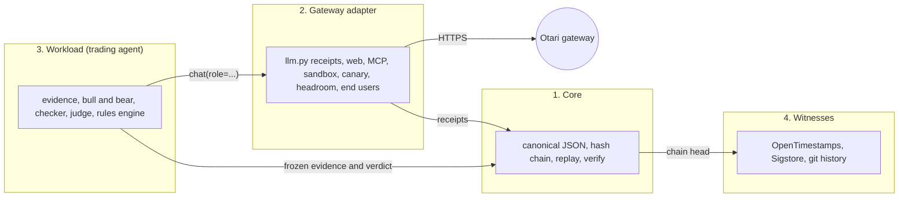

# Architecture

Tally Desk on Otari is a tamper-evident receipt layer for an agent that calls models through an AI gateway. Every model or tool call leaves a receipt, the receipts are sealed with the agent's decision into a hash-chained ledger, and anyone can check the chain and replay the decision offline. The paper-trading agent in this repository is the reference workload that exercises it.

The code falls into four parts. The first two are the product, the third is one example of a workload, and the fourth is how the outside world holds a copy of the chain head.

Python 3 and its standard library are enough; there is no dependency to install. The browser pages are static files that recompute the same hashes.

## 1. Core

Nothing here knows about markets or models. It is the part a second agent reuses as it is.

| Piece | Where | What it does |
|---|---|---|
| Canonical JSON | `verdict_desk/canonical.py` (`canonical(obj) -> bytes`), `web/canonical.js` | Sorted keys, no whitespace, numbers printed the way ECMAScript prints them (RFC 8785 style), so Python and the browser hash the same text. `tests/canonical_vectors.json` pins the two together. |
| Hash chain | `dossier.digest(body)`, `dossier.GENESIS`, `ledger/ledger.jsonl` | One JSON object per line. `hash` is the SHA-256 of the canonical body, and the body holds `prev_hash`. The first `prev_hash` is 64 zeros. |
| Verify | `dossier.verify(ledger)`, `python3 -m verdict_desk verify`, `web/verify.html` | Walks the chain: every `prev_hash` must match the record before it and every hash must match its body. An edit, deletion, swap or truncation is reported by sequence number. |
| Head | `dossier.head(ledger)` | The `{seq, hash, symbol}` of the last record, refused if the chain is broken. It is what the witnesses copy. |
| Replay | `dossier.replay(dossier, rules_version)`, `python3 -m verdict_desk replay` | Recomputes features and the verdict from the evidence frozen in the record and compares them with what was recorded. It also rechecks what can be recomputed without a network: that every accepted claim still validates against the frozen evidence, the judge route, the canary verdict, the web excerpt check, the MCP price check and the local half of the sandbox check. |
| Attack battery | `verdict_desk/battery.py`, `python3 -m verdict_desk battery` | Edits, deletes, swaps, forges, truncates and re-hashes a copy of the ledger and counts what the verifier misses. |

A record is `{seq, prev_hash, ...fields, hash}`. Which fields exist is the workload's business. The only fields the core itself reads are `seq`, `prev_hash` and `hash`, plus `evidence.symbol` in `dossier.head` (or `workload.name` for a `receipts/1` record, see "Bring your own agent").

Three functions in `dossier.py` are tied to the trading workload: `build` and `append` (they run the trading steps of section 3) and `replay` (it dispatches by `rules_version` to the trading modules). A record of kind `receipts/1` skips all three: `verdict_desk/seal.py` builds and appends it, and `replay` hands it to `seal.replay`.

## 2. Gateway adapter

This is the Otari-specific part. It lives mostly in `verdict_desk/llm.py` (the Otari and receipt functions), with the tools in their own modules.

**Calls and roles.** `llm.chat(system, user, role=..., max_tokens=..., end_user=..., extra=...)` returns the model's text. It always goes to the gateway (`_otari_chat`); with `OTARI_API_KEY` unset it raises one error (`llm.NO_KEY`) and sends nothing, so there is no second provider path. `config/otari.json` maps each role to one open-weight catalog id (`llm.role_model`, validated by `llm.otari_config`) and optionally to a routing policy (`llm.sent_model`). There are nine roles: `bull`, `bear`, `judge`, `checker`, `narrator`, and four tool roles (`searcher`, `fetcher`, `sandbox`, `mcp`).

**Role fallback chains.** A core role may also list `fallbacks` in `config/otari.json`: ordered open-weight catalog ids that already answered in our receipts, the last one a DeepSeek model. When the gateway refuses the first model for a model-side reason (402 `pricing_required`, an unknown or unavailable model, a 5xx that outlived the retries) `llm._otari_chat` asks the next entry, with the same end user and inside the same cycle caps. A budget refusal (403 `budget_exceeded`, any budget scope, the app's own cycle cap) never moves on, because another model would spend the same money. The receipt that stays is the last attempt's and carries `role_fallback`: the chain, which entry answered and, for each skipped one, its model, reason, status and request id. A call served by its first model has no such field, so older receipts stay valid. This is the app's own fallback; Otari's provider failover (`Otari-Fallback`, `attempt_count`) is a different thing, and `otari_report` and `web/cycle.html` count and label the two apart. The tool roles have no chain: their tool loop is proven only on their first model.

**Receipts.** After each call `llm.served_receipt()` returns the sealed `otari-receipt/1` of the last call on this thread, read once. `llm.parse_receipt` builds it from the response headers and the usage block: request id (Otari's own, or `client:<idempotency key>` when the gateway never answered), model asked for, provider and model that answered, attempts, fallback, duration, tokens, cost as the string Otari sent, guardrail result, end user and budget. `_seal_exchange` adds how the call stopped and the SHA-256 of the prompt and of the answer, so a stored answer is tied to its prompt without storing either. A refusal or a failure gets a receipt too (`refusal_receipt`, `transport_receipt`), so no call is anonymous.

**Guardrail.** `config/otari.json` has a `guardrails` section: the custom profile `tally-web-injection`, `mode`, `on_unavailable`, the roles whose requests carry it, and a switch `enabled` that is **false** (OTARI_GUARDRAILS=0 or 1 overrides it). When it is on, `llm.guardrail_request(role)` gives the `guardrails` entry that `_otari_chat_once` and `messages_call` add to every request of the analysts, the checker, the judge, the narrator and the search and fetch tools; the failover canary and the other drills send `extra={"guardrails": None}` and carry none. The endpoint and the bearer credential are not in the repository: they belong to the organization mandate in the Otari dashboard. `parse_receipt` keeps each `Otari-Guardrails` entry (profile, mode, valid, score, status, reason) and `guardrails_requested` records what the call asked for, so a missing header differs from a guardrail never asked for. A block answers `403 guardrail_violation`; `OtariError.detail` and the refusal receipt keep the flagged profile and score. `otari_report.audit` counts row 5 only from sealed receipts whose entry for the custom profile says `status: evaluated`; `guardrail_views` is what the cycle page chip shows (`web/cycle.js` `guardrailsOf` writes the same words). The service itself is `services/guardrail/` (zero dependencies, deployable as a Cloudflare Worker or as Vercel functions, rules and not a model); its tests run with `node --test tests/*.test.js`.

**Per-role end users and budgets.** Each role is billed to its own end user, `end_user_prefix` plus the role (`vd-judge`). The `Otari-End-User-Budget` header carries the budget id when the call creates the end user. Otari enforces the budget. The app adds its own caps on top: `llm.cycle_cap` and `_cycle_check` stop starting new calls once a cycle has spent its limit, and the refusal is a client-side receipt (`cycle_cap_exceeded`), never presented as Otari's. `llm.cycle_status()` is sealed into the dossier.

**Retries.** One logical call keeps one `Idempotency-Key` across retries, so a lost reply is not billed twice. A `409 ... still in progress` is polled for on the same key (`_poll_delay`), separately from real failures (`_retry_or_raise`).

**Tools and checks driven through the gateway.**

| Module | What it does | What is sealed |
|---|---|---|
| `otari_web.py` | One web search and one page fetch through Otari's tools (`collect`, `fetch_page`) | The sources Otari reports, a verbatim excerpt with its hash, and `excerpt_check` against our own GET of the page |
| `otari_mcp.py` | Reads prices from a public MCP server through Otari's managed loop (`collect`), checks the code the model wrote, cross-checks the price against the exchange (`check_for`, `apply`) | The server's own result block and the check. A trusted price that diverges beyond tolerance makes the packet's freshness fail closed |
| `sandbox_rederive.py` | Re-derives the verdict arithmetic in Otari's code sandbox with a fresh nonce (`seal`) and compares it with a local run (`run_local`, `agrees`) | Both outputs, the nonce proof, the code that ran, whether they are identical. `recheck` redoes the local half in a replay |
| `otari_canary.py` | One small call per cycle through a policy built to fail over (`run`, `passes`) | The receipt, with `Otari-Fallback` and the attempt count |
| `llm.read_headroom` | Reads each end user's spend from `GET /end-users` (`end_user_lookup`) | The numbers and how each lookup went. `llm.route_decision` uses them, and the canary, to decide whether the judge may take the larger model |
| `otari_report.py` | `audit` proves the eight Otari resources from sealed receipts, `reconcile` compares receipts with Otari's usage log by request id, `board` groups every call by the model that answered | Nothing: it reads the ledger, prints, and refreshes the README blocks |
| `source_drift.py` | Reads again, through the fetch tool, the page an earlier dossier cited (at least two hours old) and compares the normalized passage (`collect`, `recheck`) | `drift`: unchanged, changed, unavailable or none, with both hashes. It is a freshness receipt that no rule reads, so it cannot move a verdict |
| `closure.py` | The closure gate: deterministic checks on the finished candidate before it is appended (`seal`, `recheck`) | `closure`: nine checks, six hard and three soft. A failed hard check (`analysts_answered`, `receipts`, `evidence_frozen`, `verdict_replays`, `checker_gate`, `narrative_flagged`) appends nothing and writes `ledger/closure-refusals.jsonl`; a soft one is sealed as a warning. A tenth check, the soft `guardrail_ran`, exists only in a cycle run with the guardrail switch on (the run summary names it), so older dossiers and a cycle with the switch off replay as before |
| `otari_drill.py` | Real requests that show a fallback, the app's own role chain (`otari-drill role-fallback`), a budget refusal and a guardrail block (`otari-drill guardrail`, never part of `all`) | Written to `docs/evidence/otari-drills.jsonl`, not to the ledger |

`web/cycle.html` (with `web/cycle.js`) draws one cycle from these receipts as a timeline.

## 3. Workload: the trading agent

Everything below is specific to paper trading. A different agent would replace this part and keep the other three.

| Step | Where | Notes |
|---|---|---|
| Evidence | `evidence.collect`, `narrative.build`, `otari_web.collect`, `otari_mcp.collect` | Public candles, funding, news and market voices, plus one web page and one MCP price read. Collected once and frozen in the dossier's `evidence`. |
| Features | `features_v2.compute(packet)` | Indicators computed from the frozen packet only. |
| Evidence index | `citations.index(packet, feats)` | Stable ids (E1, E2, ...) for every citable fact. |
| Bull and bear | `llm.argue(side, items)`, `citations.validate(claims, items)` | Each analyst, on its own model, returns claims that cite ids. A claim survives only if its ids exist and its numbers appear in the cited items. |
| Checker | `llm.check_claims(labels, items)` | A third model re-reads each surviving claim against its citations. |
| Judge | `llm.rule(labels, items)`, `citations.validate_ruling` | Sees only validated claims. Routed by `llm.route_decision`. |
| Rules engine | `agents_v7.decide`, built on `agents_v2` (`bull`, `bear`, `judge`, `checker_gate`) | Plain deterministic code. It turns the weighted arguments into a paper-trade verdict inside declared risk limits. Under rules v7 a claim the checker marked unsupported voids a judge lean that rests on it. |
| Wiring | `dossier.analyst_layer`, `dossier.build`, `dossier.append` | Runs the steps above in order, lets the closure gate inspect the candidate, and seals the body with `digest`. `_mods(rules_version)` picks the module set, so older dossiers replay under the rules they were recorded with. |
| Entry point | `python3 -m verdict_desk decide-v7 BTCUSDT --config config/voices.json` | `_decide_flow` in `verdict_desk/__main__.py`. |

Only the verdict arithmetic is re-derived. Model text cannot be regenerated, so the replay checks that every accepted claim still validates against the frozen evidence and that the checker marks and the route recompute from what was sealed.

## 4. Witnesses

A hash chain shows that a record was not edited after it was written. It does not show who held the whole chain. The witnesses are copies of the head that the operator does not control.

| Witness | Where | Status in the Otari era |
|---|---|---|
| OpenTimestamps (Bitcoin) | `tools/otari_runner.py` writes `ledger/timestamps/<seq>.json` from the head and stamps it with `ots stamp`; `web/ots.js` and `web/witnesses.html` check the proof in the browser | Continues every cycle. A fresh proof reads pending until a calendar answers with a Bitcoin block, and the runner asks again for the newest earlier proofs. |
| Sigstore (Rekor) | `ledger/rekor/*.bundle.json`, `web/rekor.js` | Bundles exist up to dossier 791. They were signed by the earlier project's workflow, which is not in this repository. |
| Git history | The runner's commits | The commit time of each pushed dossier is a clock the operator does not set. |

`python3 -m verdict_desk witnesses` writes the index the witnesses page reads, and `battery` also attacks the witness checks. The earlier project also anchored heads on the Sepolia testnet; that workflow stays in its frozen repository and nothing here uses a chain.

## Every part, named once

Each part of the repository is either **integrated** (it runs in the Otari cycle or checks its output) or **history-required** (nothing in the cycle calls it, but a dossier already in the chain can only be verified or replayed with it). Anything that was neither was removed from this repository; the frozen repository [AndriyAmaro/verdict-desk](https://github.com/AndriyAmaro/verdict-desk) still has it.

**`verdict_desk/` (30 modules).**

| Module | Class | Role |
|---|---|---|
| `llm`, `otari_web`, `otari_mcp`, `sandbox_rederive`, `otari_canary`, `source_drift`, `otari_drill`, `otari_report` | integrated | The gateway adapter of section 2. `otari_drill` and `otari_report` are the proof side: the drills and the audit of the eight resources. |
| `closure` | integrated | The closure gate, run by `dossier.build` before a dossier is sealed. |
| `canonical`, `dossier`, `battery` | integrated | The core of section 1: canonical JSON, the chain, `verify`, `replay`, the attack battery. |
| `evidence`, `features_v2`, `citations`, `narrative`, `voices`, `trust`, `agents_v2`, `agents_v7` | integrated | The trading workload of section 3. `agents_v2` is also the base of every later rules version. |
| `portfolio`, `livestats` | integrated | Mark the simulated positions and count the live numbers; `web/ask.html` and `web/dashboard.html` have JavaScript ports and parity tests. |
| `__main__`, `__init__` | integrated | The command line (below). |
| `agents`, `features` | history-required | Rules v1 and its features: 56 dossiers, all among the first hundred, were recorded under them and `replay` re-derives their verdicts. |
| `agents_v3`, `agents_v4`, `agents_v5`, `agents_v6` | history-required | Rules v3 (57 dossiers), v4 (33), v5 (96) and v6 (511): `replay` picks the module by each dossier's `rules_version`. v2 (48 dossiers) and v7 (the live rules) are the integrated pair above. |

**Commands (14).** `decide-v7` (one cycle), `verify`, `replay`, `otari-audit`, `otari-drill`, `battery`, `witnesses`, `export` and `packs` (evidence packs, read by `web/ask.html` and `web/verify.html`), `market` (the candles `web/ask.html` replays), `stats` (the numbers of `web/dashboard.html`), `portfolio`, `trust` and `trust-check` (the voices' track record that rules v5 to v7 freeze into each dossier).

**Everything else.**

| Part | Class | Role |
|---|---|---|
| `config/otari.json`, `config/voices.json`, `config/external_hosts.json` | integrated | Roles, models, fallback chains, caps and policies; the news voices and the default risk limit; every host the code names (a test keeps it complete). |
| `tools/otari_runner.py` | integrated | The job the workflow `otari-cycle` runs every hour. |
| `tools/otari_catalog_check.py` | integrated | Checks every model and fallback of `config/otari.json` against the public catalog. |
| `scripts/site_shell.py`, `scripts/otari_cards.py`, `scripts/readme_cards.py`, `scripts/refresh_otari_readme.py` | integrated | Generate the site header and footer, the README cards and the README blocks. The product name lives in `site_shell.NAME`. |
| `scripts/check_pages.sh` | integrated | Renders the pages in headless Chromium and checks what arrived. |
| `web/` | integrated | `index`, `cycle`, `verify` (the three main pages), `dashboard`, `witnesses`, `ask`, `lab`, `narrative` and their scripts; `web/policy.js`, `canonical.js`, `trust.js`, `stats.js` and `chart.js` are the browser ports the parity tests compare with Python. |
| `ledger/` | integrated | The chain, its head files, the OpenTimestamps proofs and the Sigstore bundles. |
| `docs/` | integrated | This file, the feedback log, the lineage, the evidence files and the README images. |
| `tests/` | integrated | The suites of the Tests section. |
| `.github/workflows/otari-cycle.yml` | integrated | The only workflow. |

**Removed.** The Chainlink CRE anchor on Sepolia (`cre/`, `anchor.py`, `monitor`, `head`), the Sepolia practice desk (`practice.py`), the printable exhibits and the pages written for lawyers (`web/legacy/`, `exhibit.py`), the self-hosted model gateway and its routing files, the Mistral, native Claude and keyless client paths, the research and backtest tools, the scorecard, the scoreboard, the journal audit, the weight learner, the cadence check, the commands `decide` to `decide-v6`, and the public-export script.

## One cycle, in order

1. `tools/otari_runner.py --once` (run by the workflow `otari-cycle`) starts `decide-v7` for one symbol.
2. `llm.reset_cycle()`. The narrator reads headlines, `otari_web.collect` searches and fetches one page, `source_drift.collect` reads one earlier page again, `otari_mcp.collect` reads prices, and `evidence.collect` gathers candles, funding and news.
3. `dossier.build` computes the features. `analyst_layer` runs bull, bear and checker (each may go down its role fallback chain), then the canary and the headroom read, then the judge. `agents_v7.decide` produces the verdict, `sandbox_rederive.seal` re-derives it in the sandbox.
4. `closure.seal` inspects the finished candidate. If a hard check fails, nothing is appended, the runner commits only `ledger/closure-refusals.jsonl`, and the next cycle goes on. Otherwise `digest` seals the record, `dossier.append` writes the line and `publish_head` refreshes `ledger/head.json`.
5. The runner runs `verify` and `replay`, stamps the head, refreshes the README blocks, scans for secrets, commits and pushes to `otari`.

## Bring your own agent

A second agent can seal its Otari calls with `verdict_desk/seal.py`. [`docs/bring-your-own-agent.md`](bring-your-own-agent.md) has the short sketch (it runs in the test suite), the guarantees, the generic closure checks and the limits; [`examples/`](../examples/README.md) has a complete agent that is not about trading. What follows is how the parts fit and what a second workload still touches.

**1. Roles.** The agent's roles live in a role config like `config/otari.json` (`examples/otari_roles.json` is a minimal one) and are passed as `Session(config=...)`. Each role has a catalog `model`; `llm.otari_config` refuses a role without one and `llm.chat` refuses a role that is not listed. `tools/otari_catalog_check.py` checks that ids are real and open-weight. Adding roles to `config/otari.json` itself changes the config hash every trading dossier seals, so a foreign agent uses a file of its own.

**2. Calls.** `Session.ask(role, system, user, ...)` calls `llm.chat` and keeps `llm.served_receipt()` for that call, failures included. Receipts, per-role end users, the budget header, idempotent retries, role fallbacks and the cycle caps come with it. A session starts with `llm.reset_cycle()` and seals `llm.cycle_status()`.

**3. A deterministic decision.** If the agent has one, it is the agent's own function from its frozen outputs to its decision, which is what `agents_v2.decide` is for trading. If its claims should cite evidence, `citations.validate(claims, items)` works on any `{id: text}` dict, but `citations.index` reads `packet["market"]` and the prompts in `llm.argue` and `llm.rule` are about a market debate, so the agent writes its own index and prompts.

**4. Sealing.** `Session.seal()` builds a record of kind `receipts/1`: the workload name and mode, the frozen input and its sha256, the outputs, the receipts of every call, `llm.otari_summary()` and the cycle spend. It runs the generic closure (`seal.CHECKS`: calls accounted, receipts schema, input frozen, priced within the cap, and two soft checks) and appends the record, in the same chain format `dossier.verify` reads, to the ledger the caller named. If a hard check fails nothing is appended and the reasons are returned. The API refuses `ledger/ledger.jsonl` and any ledger that holds a record that is not `receipts/1`.

**5. Replay.** `dossier.replay` hands a `receipts/1` record to `seal.replay`: it recomputes the hash, the shape of the record, the schema of every receipt and the closure, and reports `no rules to re-derive (receipts record)` with `replayed` set to `None`. No verdict is re-derived, because a foreign workload has no rules here; an agent whose decision is deterministic ships its own replay. Trading dossiers take the same path as before. In the browser, `web/receipts.js` does the same recomputation (`tests/test_seal.py` compares it with Python), and `web/verify.html` shows the record as verified for integrity and linkage and says there is no verdict to re-derive. It checks the link among the pasted records, never against the published trading ledger.

**6. Audit and the call-by-call page.** `otari_report.calls_of` and `callsOf` in `web/cycle.js` look for receipts only in the fixed places of a trading dossier (`evidence.narrative.receipts`, `evidence.web.receipt`, `evidence.web.page.receipt`, `evidence.market_mcp.receipt`, `llm.bull`, `llm.bear`, `llm.checker`, `llm.judge`, `llm.otari.canary.receipt` and `sandbox.receipt`). A `receipts/1` record keeps its receipts in `calls`, so the audit (`otari_report.audit`, written for the nine trading roles) and the cycle page do not read it. A second agent that wants them extends both functions together (`tests/test_otari_report.py` and `tests/cycle.test.js` compare the Python and JavaScript sides).

**7. Witnesses.** `dossier.head` gives the head of a receipts ledger too (the workload name stands in for the symbol) and `ots stamp` can stamp it, but the loop that does this every cycle is `tools/otari_runner.py`, which is written for `decide-v7` and three symbols. A second agent needs its own loop or a runner generalized to take a command.

What still stands between this and a full second product: a per-workload replay hook (`seal.replay` stops at the record), a receipt reader for the audit and the cycle page that is not tied to fixed places, and a generalized runner. The API has not been run against the live gateway yet; the tests use a fake transport.

## Trust model and limits

- The chain proves integrity after recording, not honesty at collection time. A packet could in principle be fabricated before it is hashed. Public market data that anyone can re-fetch, the OpenTimestamps stamps and git history narrow that gap and do not close it.
- Receipts record what the gateway said. The usage record Otari keeps carries cost, tokens and status but not the model, so the model on a receipt cannot be reconciled against Otari's record (feedback log, entry 20).
- Guardrails: `services/guardrail/` is the screen we built (below). It runs on Cloudflare Workers, is mandated in the Otari dashboard, and the switch (`guardrails.enabled`) is on. Otari reports its verdict in the receipt of each screened call, and audit row 5 reads those receipts. Monitor mode: it records and never stops a cycle.
- Secrets: the only secret is `OTARI_API_KEY`, read from the environment. It is never written to a dossier, a log or an error message, and the runner scans every changed file for it before committing.
- Every position is simulated. No order is routed anywhere and no key with trading rights exists.

## Tests

`env -u OTARI_API_KEY python3 -m unittest discover -s tests -q` runs the Python suite with no network and no key. `node --test tests/*.test.js` runs the browser code (verifier, cycle page, stats). The suite guards the chain against edit, delete, swap, forge and truncate attacks, the parity of the Python and JavaScript verifiers, the audit and the generated README blocks. No test spends on Otari or sends a transaction.
